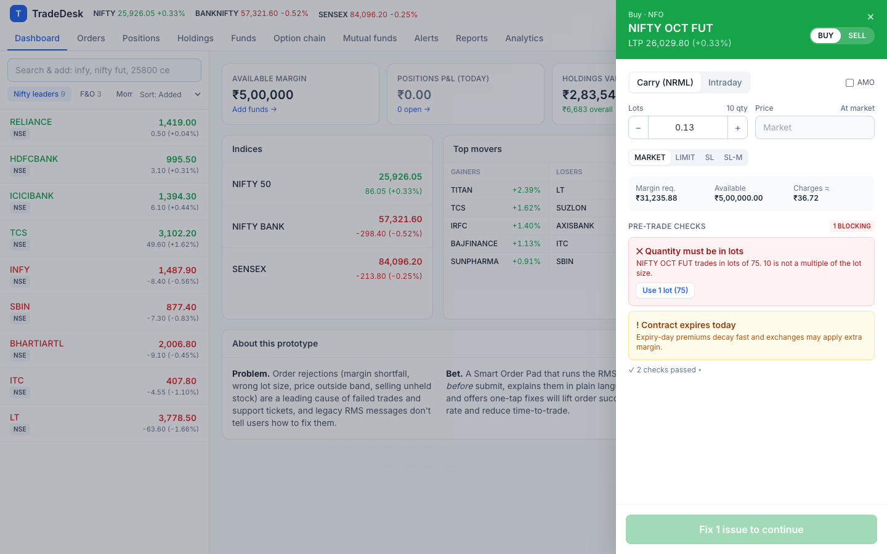

# TradeDesk — Trading Platform Prototype & PM Case Study

A working web prototype of a broking app's core trading journeys, built around one product bet:

> **Smart Order Pad** — catch order rejections *before* the user hits submit, explain them in plain language, and offer one-tap fixes. Instrumented end-to-end with a live A/B toggle.

**📄 Start here: [Product case study](docs/00-case-study.md)** — problem, insight, solution, metrics, and links to every PM artifact.



> All market data, prices, lot sizes and funds are **simulated**. No real orders are placed and no real broker or exchange is connected.

## What's inside

| Module | Highlights |
|---|---|
| **Watchlist** | Multiple lists, search equity/F&O, live ticks, hover Buy/Sell/Chart/Alert |
| **Smart Order Pad** | MARKET/LIMIT/SL/SL-M · CNC/MIS/NRML · lots · AMO · live margin & charges · 10 pre-trade checks with one-tap fixes · review step |
| **Order Book** | Open/Executed/Rejected, modify, cancel, partial fills, plain-language rejection + Fix & retry |
| **Positions** | Live MTM, realised/unrealised, Add, Exit, Exit all |
| **Holdings** | Stocks + mutual funds, day P&L, sector allocation |
| **Funds** | Margin breakup, add (UPI/net banking), withdraw, ledger |
| **Reports** | P&L by symbol, tradebook, charges, CSV export |
| **Charts** | Candles, volume, 1m/5m/15m/1D, SMA/EMA, market depth (TradingView Lightweight Charts) |
| **Option Chain** | NIFTY weekly chain priced with Black-Scholes, OI, IV, delta, PCR, max pain |
| **Mutual Funds** | Explore, NAV trend, SIP calculator, start/pause SIP, lumpsum |
| **Alerts** | Price alerts with simulated WhatsApp Business delivery and Buy/Sell quick replies |
| **Analytics** | Funnel and rejection rate per A/B variant, live event stream |

## How this maps to the job description

| JD asks for | Where it's demonstrated |
|---|---|
| Own Watchlist, Order Pad, Order Book, Positions, Portfolio, Funds, Reports | All built; PRDs in [04](docs/04-prd-trading-modules.md) |
| PRDs, user stories, wireframes, process flows | [03 PRD](docs/03-prd-smart-order-pad.md) · [05 stories](docs/05-user-stories-backlog.md) · [07 wireframes](docs/07-wireframes.md) · [06 flows](docs/06-process-flows.md) |
| Equity, derivatives, mutual funds knowledge | Margin model, lot/freeze/circuit rules, option chain with Greeks, SIP flows |
| Mobile & web trading products | Responsive app: desktop multi-panel + mobile bottom-tab layout ([mobile preview](public/mobile.html)) |
| Trading charts | Candles, volume, indicators, depth |
| APIs, JIRA, Agile | [API spec](docs/08-api-spec.md); UI talks only to a REST-shaped mock API; JIRA-style backlog & sprint plan |
| Data-driven decisions, analytics | [Tracking plan](docs/09-analytics-tracking-plan.md) with metrics tree, experiment design; in-app Analytics tab |
| *Preferred:* Client APIs, algo trading | Client API & algo programme section in [08](docs/08-api-spec.md); roadmap in [10](docs/10-roadmap-and-prioritization.md) |
| *Preferred:* WhatsApp integrations | Alerts with WhatsApp template preview & deep-link quick replies |
| *Preferred:* Personalisation, analytics tracking | Roadmap theme + full event taxonomy |

## Run it

Requires Node 18+.

```bash
npm install
```

```bash
npm run dev
```

Open http://localhost:5173. Phone-width preview: http://localhost:5173/mobile.html

```bash
npm test
```

Deep links for demos: `/?page=chart&symbol=INFY`, `/?pad=INFY&side=SELL&qty=50`, `/?variant=classic`, `/?tour=0`. The ↺ button in the header resets demo data.

### Two-minute demo script

1. Dashboard → Guided tour → **"Use a one-tap fix"**: futures order with qty 10 → *Use 1 lot (75)* → Review → Confirm.
2. **Positions** → Exit. See realised P&L in **Reports**.
3. Watchlist → hover **LT** → **S** (you don't hold it) → see *Switch to Intraday*.
4. Header **A/B → Classic pad**, repeat step 3 → order is rejected with raw RMS text.
5. **Analytics** tab → compare funnels and rejection rates per variant.
6. **Alerts** → create an alert near LTP with WhatsApp on → wait for the WhatsApp toast → tap *Buy now*.

## Project structure

```
src/
  api/          mockBroker.ts (REST-shaped API), types.ts
  engine/       riskChecks.ts (pre-trade RMS), margin.ts, orderEngine.ts (matching), pnl.ts
  market/       instruments.ts, feed.ts (seeded simulator), blackScholes.ts
  analytics/    events.ts (taxonomy), track.ts
  store/        Zustand stores (market, trading, ui)
  features/     one folder per screen
tests/          unit tests for risk checks, matching and P&L
docs/           PM documentation (start at 00-case-study.md)
scripts/        screenshots.sh (regenerates docs/images with headless Chrome)
```

Tech: React 18, TypeScript, Vite, Tailwind CSS, Zustand, TradingView Lightweight Charts, Vitest.
