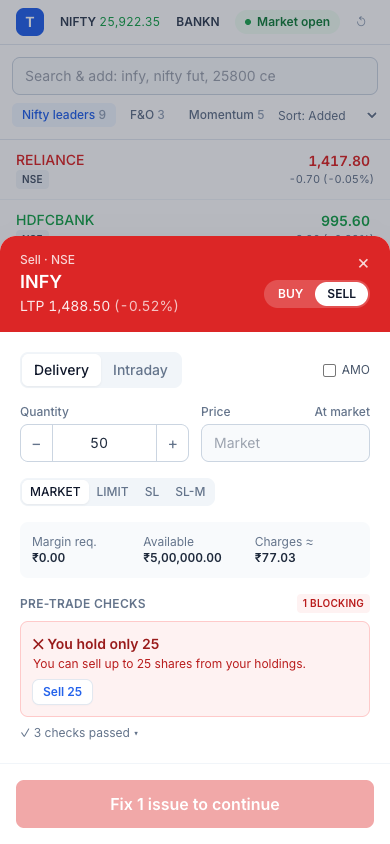

# TradeDesk — Smart Order Pad: a Product Case Study

> **One line:** Catch order rejections *before* the user taps submit, explain them in plain language, and offer one-tap fixes — then prove it with an instrumented A/B test.

| | |
|---|---|
| **Role** | Product Manager (solo: discovery → PRD → prototype → metrics plan) |
| **Surface** | Mobile web + desktop web trading app |
| **Modules covered** | Watchlist · Order Pad · Order Book · Positions · Holdings/Portfolio · Funds · Reports · Charts · Option Chain · Mutual Funds/SIP · Price Alerts (WhatsApp) |
| **Artifacts** | Working prototype, PRDs, backlog with acceptance criteria, process flows, wireframes, API spec, analytics tracking plan, RICE roadmap, GTM plan |
| **Status** | Prototype on simulated data. All metric targets are hypotheses to validate, not measured results. |

---

## 1. The problem

Every broker's Risk Management System (RMS) rejects a share of orders. The common causes are predictable and the user could have avoided them:

| Rejection cause | What the user typically sees (legacy RMS text) |
|---|---|
| Insufficient margin | `RMS:Margin Exceeds,Required:234072.00, Available:198000.00 for entity account-... across exchange across segment across product` |
| F&O quantity not in lot multiples | `RMS:Quantity should be multiple of lot size 75` |
| Order above exchange freeze quantity | `Freeze quantity exceeded` |
| Limit price outside circuit band | `RMS:Rule: Check circuit limit including square off order exceeds` |
| Delivery sell without holdings | `RMS:Holding not available` |
| Stop-loss trigger on the wrong side of LTP | `Trigger price for stoploss buy orders should be higher than last traded price` |
| Regular order after market hours | `Market Closed` |

The messages arrive **after** the user has committed, often seconds before a move they wanted to catch. They are written for the back office, not for the trader, and none of them say what to do next.

**Why it matters to the business**

- A failed order is a lost brokerage and turnover event, and sometimes a lost customer.
- Rejections drive "why was my order rejected" support tickets and app-store complaints.
- New-to-market users (the fastest-growing segment since 2020) are the most likely to hit them on their first trades — the moment that decides activation.

## 2. Insight

> Every one of these rules is deterministic and the data needed to evaluate them (LTP, circuit band, lot size, freeze qty, available margin, holdings) is already on the client. **The RMS check can run while the user is typing.**

## 3. Solution: Smart Order Pad

1. **Live pre-trade checks** run on every keystroke and tick — market session, quantity/lot/freeze, product validity, tick size, circuit band, SL trigger, holdings, margin.
2. **Plain-language explanations** replace RMS codes: *"Short by ₹36,072. This order needs ₹2,34,072 margin; you have ₹1,98,000. You can afford up to 75 qty."*
3. **One-tap fixes** — *Use 1 lot (75)*, *Use ₹1,702.20* (upper circuit), *Switch to Intraday*, *Place as AMO*, *Add ₹37,000 via UPI* — without leaving the pad.
4. **Heads-up warnings** that don't block: fat-finger price (>5% from LTP), MIS auto square-off, option-writing risk, expiry day.
5. **Margin, available funds and estimated charges** always visible; a review step before confirm.
6. **Order Book "Why it was rejected"** in plain language with *Fix & retry* for anything that still slips through.

| Smart pad (desktop) | Smart pad (mobile) |
|---|---|
|  |  |

## 4. How we'd know it works

North Star: **Successful orders per active trader per week.**

| Metric | Definition | Hypothesis |
|---|---|---|
| RMS rejection rate (primary) | `order_rejected / (order_placed + order_rejected)` | −40% relative vs control |
| Order success rate | `order_executed / order_pad_opened` | +5 pp |
| Time to order | median `order_review_shown.ms_since_open` | No regression (guardrail) |
| Fix adoption | `pretrade_fix_applied / pretrade_check_failed` | ≥ 35% |
| Support tickets tagged "order rejected" | per 1,000 active traders | −25% |
| Guardrail: abandonment | pad opened with no order within 60 s | No significant increase |

The prototype ships with a **live A/B toggle (Smart vs Classic)** and an **Analytics tab** that computes the funnel and rejection rate per variant from your own session. See [09-analytics-tracking-plan.md](09-analytics-tracking-plan.md).

## 5. What's in the prototype

| Area | What you can do | Screenshot |
|---|---|---|
| Watchlist | Multiple lists, search across equity/F&O, live LTP with tick flash, sort, hover B/S/chart/alert | [mobile](images/mobile-watchlist.png) |
| Charts | Candles + volume, 1m/5m/15m/1D, SMA20/EMA50, market depth, circuit limits, trade from chart | [chart](images/chart.png) |
| Order Pad | MARKET/LIMIT/SL/SL-M · CNC/MIS/NRML · lots for F&O · AMO · margin & charges · checks & fixes | [pad](images/order-pad-smart.png) |
| Order Book | Open/Executed/Rejected, modify, cancel, partial fills, rejection reason | — |
| Positions | Live MTM, realised/unrealised split, Add, Exit, Exit all | — |
| Holdings | Equity + MF holdings, day P&L, sector allocation donut | [holdings](images/holdings.png) |
| Funds | Margin breakup, add (UPI/net banking) and withdraw, ledger | [funds](images/funds.png) |
| Reports | P&L by symbol, tradebook, charges, CSV export | — |
| Option Chain | NIFTY weekly chain, OI bars, IV, delta, PCR, max pain, ITM shading, tap-to-trade | [chain](images/option-chain.png) |
| Mutual Funds | Explore by category, NAV trend, SIP calculator, start SIP/lumpsum, pause SIP | [MF](images/mutual-funds.png) |
| Alerts | Price alerts with simulated WhatsApp Business delivery and Buy/Sell quick replies | [alerts](images/alerts.png) |
| Analytics | Funnel per variant, rejection reasons, live event stream | — |

## 6. Decisions and trade-offs

- **Block vs warn.** Hard failures the exchange will reject anyway block the button; judgment calls (fat finger, option writing) only warn. Blocking a valid-but-unusual order would cost more trust than it saves.
- **Client checks are advisory; the server stays the source of truth.** The same `runPreTradeChecks` runs in the mock RMS, so client and server can't drift. In production, rules and rates would ship from a config endpoint.
- **Inline "Add funds" inside the pad.** The biggest single rejection cause is margin; sending users to a Funds screen loses the order. A UPI collect/intent from the pad keeps the context.
- **Explain, don't lecture.** Each message is one sentence on *what* and one on *how to fix*, with numbers.
- **What I deliberately left out of v1:** basket orders, GTT/OCO, iceberg auto-slicing for freeze qty (v1 caps at freeze qty and explains), and pledge-based collateral margin.

## 7. Next bets (from the roadmap)

1. **Iceberg/auto-slice** for orders above freeze quantity.
2. **No-code strategy builder** (algo) on the same order and risk layer, exposed via the client API.
3. **WhatsApp alerts → trade** with pre-approved templates and deep links (prototype included).
4. **Personalised watchlists** seeded from holdings, sector exposure and recent searches.

See [10-roadmap-and-prioritization.md](10-roadmap-and-prioritization.md) for RICE scores.

## 8. Document index

| # | Document |
|---|---|
| 01 | [Market & competitive analysis](01-market-and-competitive-analysis.md) |
| 02 | [User research & personas](02-user-research-and-personas.md) |
| 03 | [PRD — Smart Order Pad](03-prd-smart-order-pad.md) |
| 04 | [PRDs — Trading modules](04-prd-trading-modules.md) |
| 05 | [User stories & backlog](05-user-stories-backlog.md) |
| 06 | [Process flows](06-process-flows.md) |
| 07 | [Wireframes](07-wireframes.md) |
| 08 | [API specification](08-api-spec.md) |
| 09 | [Analytics tracking plan](09-analytics-tracking-plan.md) |
| 10 | [Roadmap & prioritisation](10-roadmap-and-prioritization.md) |
| 11 | [Go-to-market & release plan](11-go-to-market-and-release.md) |
