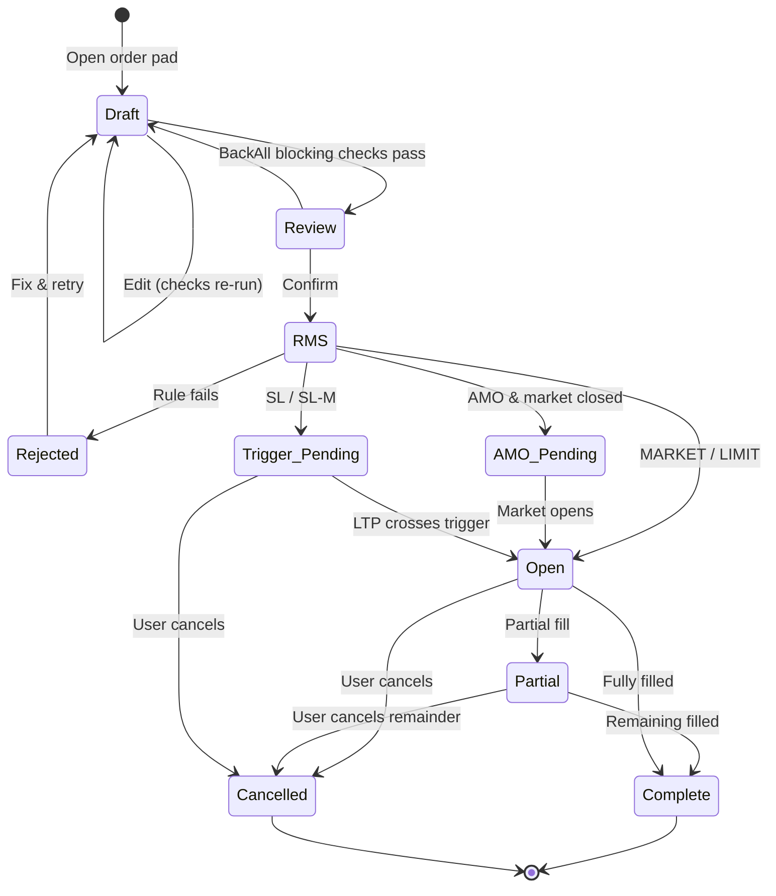
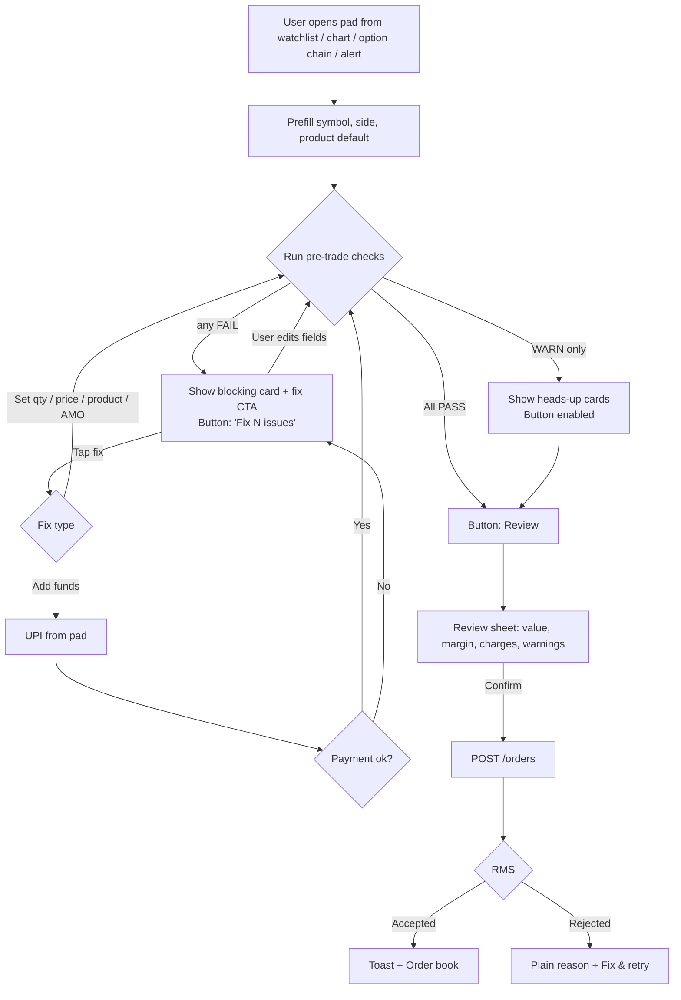
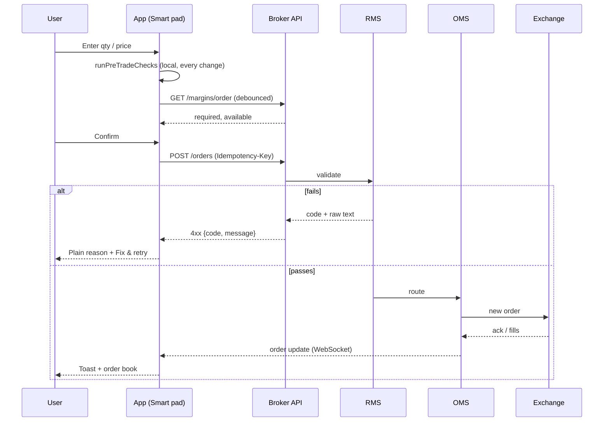
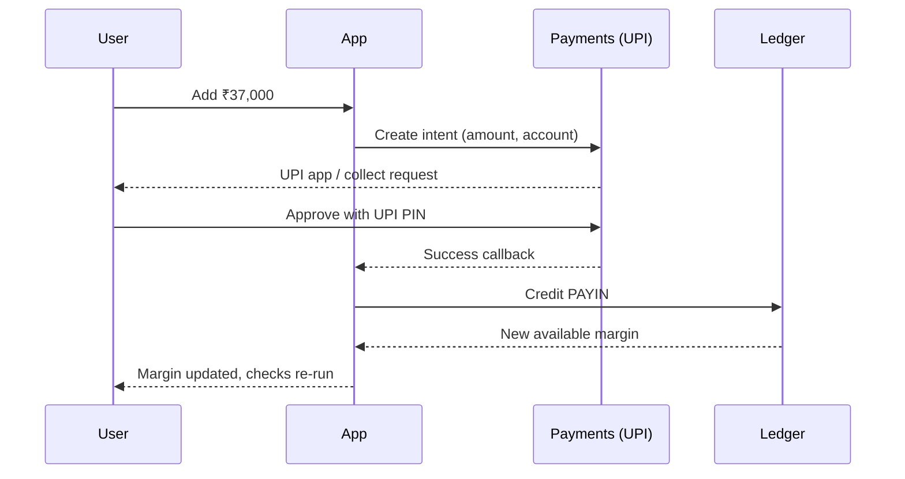
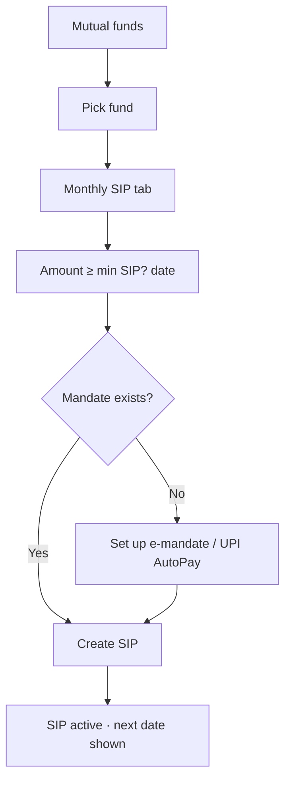
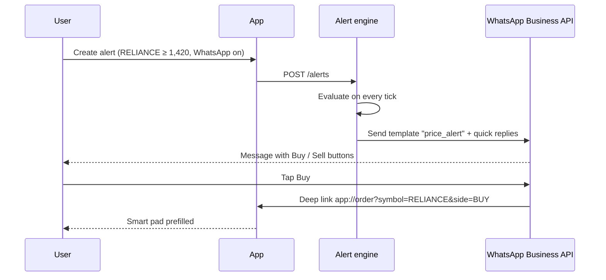

# 06 · Process Flows

Diagrams use Mermaid (renders on GitHub).

## 6.1 Order lifecycle (state machine)



## 6.2 Smart Order Pad — check & fix loop



## 6.3 Place order — sequence



## 6.4 Square-off a position

```mermaid
flowchart LR
    A[Positions] --> B[Tap Exit] --> C[Build opposite MARKET order<br/>qty = |net qty|, same product]
    C --> D[Checks: exit needs no margin] --> E[POST /orders] --> F{Filled?}
    F -->|Yes| G[Position closed · realised P&L · margin released]
    F -->|No| H[Show error + retry]
```

## 6.5 Add funds (inline or Funds screen)



## 6.6 Start a SIP



## 6.7 WhatsApp price alert → trade


