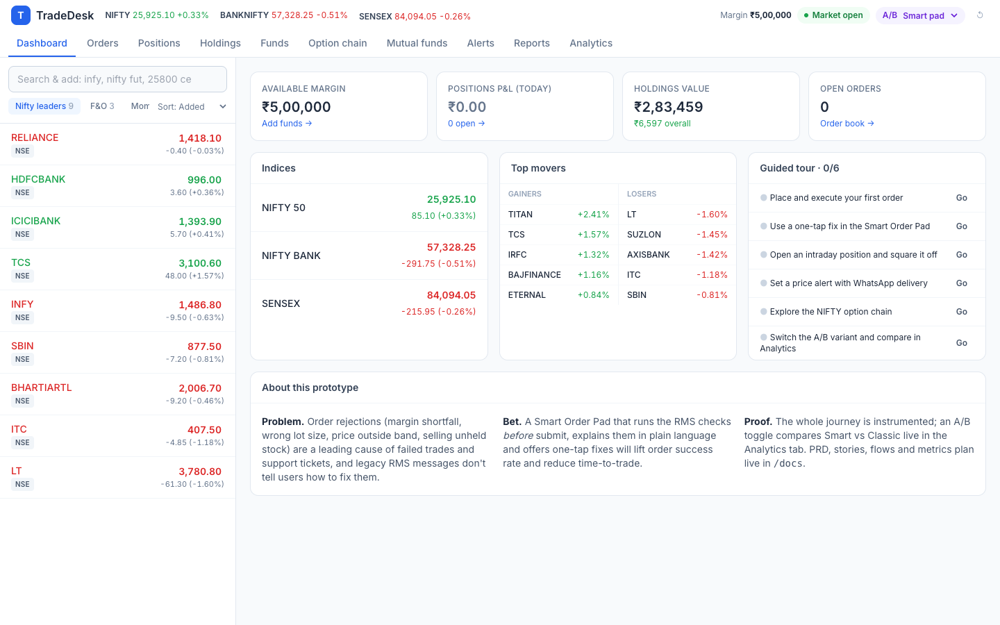
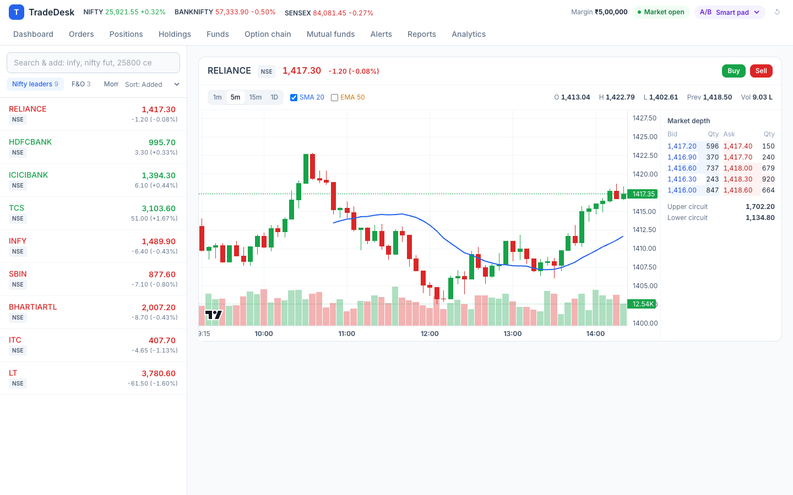
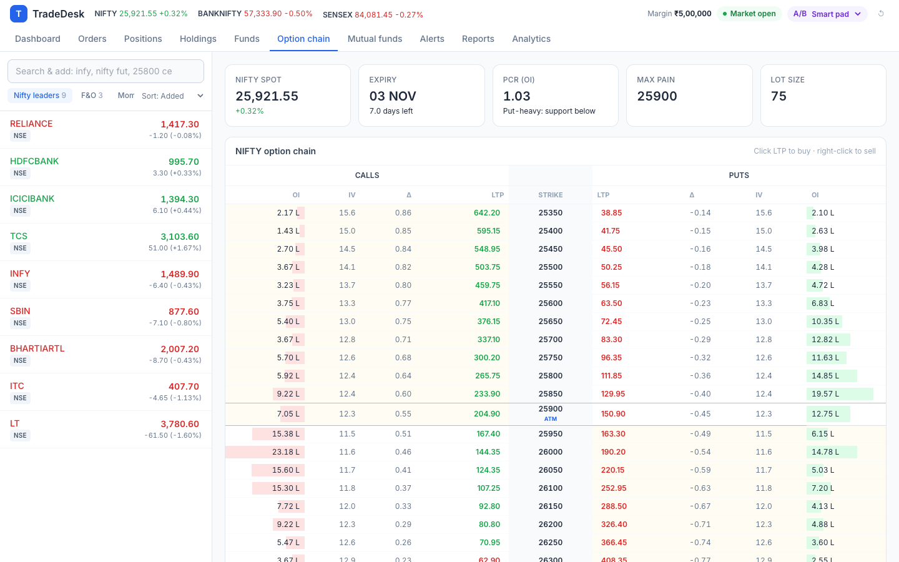
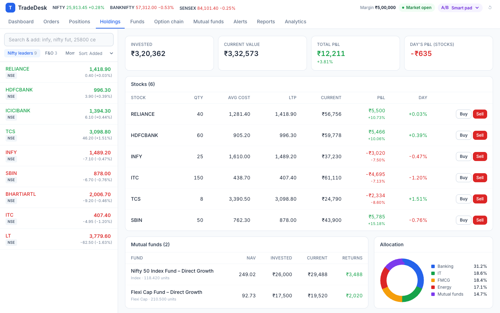
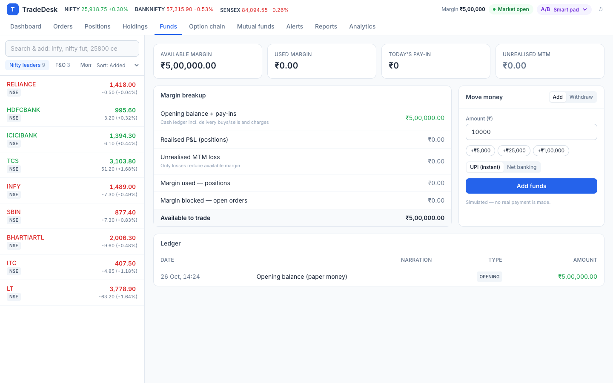
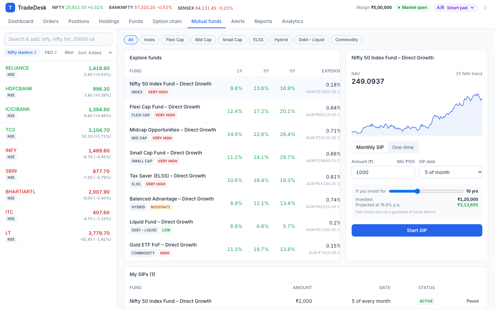
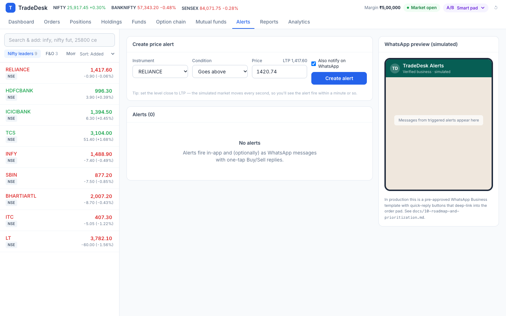
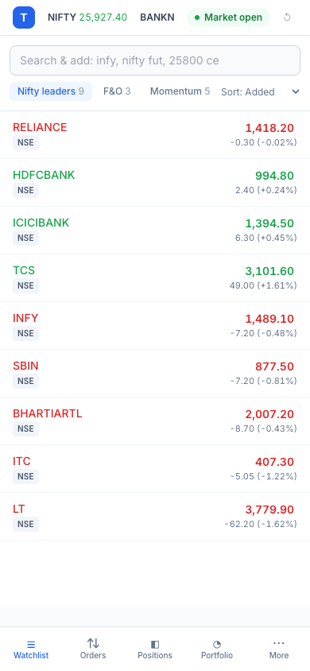
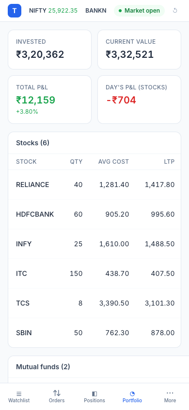

# 07 · Wireframes

Low-fidelity wireframes used to align with design and engineering, followed by the built prototype.

## 7.1 Mobile — Smart Order Pad (bottom sheet)

```
┌──────────────────────────────────┐
│ SELL · NSE                    ✕  │  ← colour = side
│ INFY            [ BUY | SELL ]   │
│ LTP 1,485.10 (−0.75%)            │
├──────────────────────────────────┤
│ [Delivery | Intraday]     ☐ AMO  │
│ Quantity        Price            │
│ [−]  50  [+]    [ Market    ]    │
│ [MARKET|LIMIT|SL|SL-M]           │
│ ┌──────────────────────────────┐ │
│ │Margin req  Available  Charges│ │
│ │ ₹0.00     ₹5,00,000   ₹76.85 │ │
│ └──────────────────────────────┘ │
│ PRE-TRADE CHECKS      1 BLOCKING │
│ ┌──────────────────────────────┐ │
│ │ ✕ You hold only 25           │ │
│ │ You can sell up to 25 shares │ │
│ │ [ Sell 25 ]                  │ │  ← one-tap fix
│ └──────────────────────────────┘ │
│ ✓ 3 checks passed ▾              │
├──────────────────────────────────┤
│ [   Fix 1 issue to continue   ]  │  ← disabled until fixed
└──────────────────────────────────┘
```

## 7.2 Mobile — Review step

```
┌──────────────────────────────────┐
│ Review your order                │
│ Order        BUY 75 (1 lot)      │
│ Type         LIMIT               │
│ Product      Carry forward (NRML)│
│ Price        25,990.00           │
│ Order value  ₹19,49,250          │
│ Margin       ₹2,33,910           │
│ Charges ≈    ₹121.94             │
│ ! Contract expires today …       │
├──────────────────────────────────┤
│ [Back]  [     Confirm buy     ]  │
└──────────────────────────────────┘
```

## 7.3 Web — Trading layout

```
┌────────────────────────────────────────────────────────────────────────────┐
│ TradeDesk  NIFTY 25,917 +0.3%  BANKNIFTY …   Margin ₹5,00,000 ●Open  A/B ▾ │
│ Dashboard Orders Positions Holdings Funds Option chain MF Alerts Reports … │
├──────────────────────┬─────────────────────────────────────────────────────┤
│ [Search & add…    ]  │                                                     │
│ Nifty leaders | F&O  │              Selected page                          │
│ RELIANCE  1,417.70   │   (Chart · Order book · Positions · Holdings …)     │
│ HDFCBANK    994.40 B S📈🔔✕ ← hover actions                                 │
│ …                    │                                                     │
└──────────────────────┴───────────────────────────────┬─────────────────────┤
                                                       │ Order pad drawer    │
                                                       │ (440px, right)      │
                                                       └─────────────────────┘
```

## 7.4 Order Book — rejected row

```
│ 14:12:05  [SELL] LT   MARKET · CNC   0/1   MKT   —   [REJECTED]   [Fix & retry] │
│   Why it was rejected: Delivery sell needs shares in your demat. To short-sell  │
│   for the day, use Intraday (MIS).                                              │
```

## 7.5 Built prototype

| Screen | |
|---|---|
| Dashboard |  |
| Chart with depth |  |
| Smart Order Pad |  |
| Option chain |  |
| Holdings |  |
| Funds |  |
| Mutual funds |  |
| Alerts + WhatsApp preview |  |

| Mobile watchlist | Mobile order pad | Mobile holdings |
|---|---|---|
|  |  |  |
