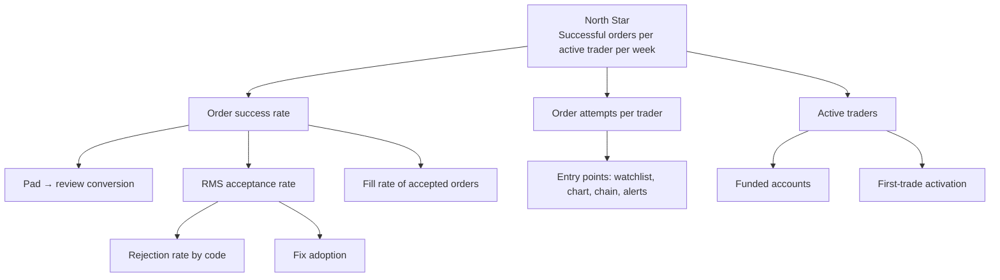

# 09 · Analytics Tracking Plan

The prototype implements this plan in [`src/analytics/events.ts`](../src/analytics/events.ts) and [`track.ts`](../src/analytics/track.ts). Open the **Analytics** tab to see the funnel and event stream computed live from your session.

## 1. Metrics tree

## 2. Global properties (on every event)

| Property | Type | Example |
|---|---|---|
| `session_id` | string | `k3j9x2ab` |
| `variant` | enum | `smart` · `classic` |
| `platform` | enum | `web` · `mobile_web` · `android` · `ios` |
| `ts` | ISO time | |
| `user_id` | hashed string | (production only) |
| `app_version` | string | (production only) |

## 3. Event taxonomy

| Event | When | Key properties |
|---|---|---|
| `app_opened` | Session start | `ua` |
| `watchlist_viewed` | Watchlist tab switched | `watchlist`, `size` |
| `watchlist_symbol_added` / `_removed` | Edit list | `symbol`, `watchlist` |
| `search_performed` | Query settles 600 ms | `query`, `results` |
| `chart_opened` | Chart/timeframe change | `symbol`, `timeframe` |
| `order_pad_opened` | Pad shown | `symbol`, `side`, `source`, `segment` |
| `pretrade_check_failed` | First time a blocking code shows in a pad session | `symbol`, `code` |
| `pretrade_fix_applied` | One-tap fix tapped | `code`, `fix` |
| `order_review_shown` | Review sheet | `symbol`, `has_warnings`, `ms_since_open` |
| `order_placed` | RMS accepted | `order_id`, `symbol`, `side`, `order_type`, `product`, `qty`, `source` |
| `order_rejected` | RMS rejected | same + `reason` |
| `order_executed` | Fully filled | `order_id`, `avg_price`, `latency_ms`, `source` |
| `order_modified` / `order_cancelled` | User action | `order_id`, changes |
| `position_squared_off` | Exit from Positions | `symbol`, `qty`, `pnl` |
| `funds_added` / `funds_withdrawn` | Payment success | `amount`, `method` |
| `report_exported` | CSV download | `report`, `rows` |
| `option_chain_viewed` | Chain opened | `underlying`, `expiry` |
| `mf_sip_started` / `mf_lumpsum_invested` | MF action | `fund`, `amount` |
| `alert_created` / `alert_triggered` / `alert_cta_clicked` | Alerts | `symbol`, `price`, `whatsapp`, `cta` |
| `experiment_variant_changed` | Demo-only toggle | `from`, `to` |

**Naming rules:** `object_action`, snake_case, past tense; properties snake_case; no PII in properties (amounts OK, names/PAN never).

## 4. Funnels & dashboards

**Order funnel (per variant):** `order_pad_opened → order_review_shown → order_placed → order_executed`

**Rejection dashboard:** rejection rate by `reason`, by `segment`, by `source`, by app version; trend vs releases.

**Fix effectiveness:** for each `code`, `pretrade_fix_applied / pretrade_check_failed`, and % of those pads ending in `order_placed`.

**Activation:** % of new funded users with `order_executed` within 7 days; median time to first trade.

## 5. Experiment design

| Item | Value |
|---|---|
| Hypothesis | Showing RMS checks pre-submit with one-tap fixes reduces avoidable rejections without slowing experienced traders |
| Unit | User (sticky) |
| Population | Active traders on app versions with the flag |
| Split | 50/50 inside a 5% rollout cohort |
| Primary metric | RMS rejection rate (per order attempt) |
| Guardrails | Time to review (power users), pad abandonment, client/server disagreement, crash rate |
| Sample size (illustrative) | Baseline rejection 8%, MDE −20% relative (8% → 6.4%), α 0.05, power 0.8 → ≈ 4,300 order attempts per arm |
| Duration | ≥ 2 full weeks to include two weekly expiries; stop early only for guardrail breaches |
| Analysis | Two-proportion z-test on rejection rate; cluster-robust SE by user; segment by persona proxy (F&O vs equity, tenure) |
| Decision | Ship if primary improves significantly and no guardrail regresses beyond threshold |

> Baseline and MDE are planning assumptions; replace with real values from the data warehouse before launch.

## 6. QA of instrumentation

- Event schema in a shared registry; CI check that `events.ts` matches the registry.
- Debug overlay in staging (the prototype's Analytics tab is the model).
- Daily anomaly alert on event volumes per app version.
