# 10 · Roadmap & Prioritisation

## RICE scoring

Reach = active traders affected per quarter (thousands, illustrative) · Impact 0.25–3 · Confidence % · Effort person-months. Score = R × I × C / E.

| # | Initiative | Reach | Impact | Conf. | Effort | **RICE** | Notes |
|---|---|---|---|---|---|---|---|
| 1 | Smart Order Pad (pre-trade checks + fixes) | 400 | 2 | 80% | 3 | **213** | Highest-frequency journey; prototype built |
| 2 | Inline add-funds from order pad | 150 | 2 | 80% | 1.5 | **160** | Bank advantage; depends on payments |
| 3 | Plain-language rejection + Fix & retry | 120 | 1 | 90% | 1 | **108** | Cheap; also helps API users |
| 4 | WhatsApp price alerts with quick replies | 200 | 1 | 60% | 2 | **60** | Template approval & opt-in needed |
| 5 | Personalised watchlists | 300 | 0.5 | 50% | 2 | **38** | Activation for new users |
| 6 | Iceberg auto-slice above freeze qty | 30 | 2 | 80% | 1.5 | **32** | Expiry-day power users |
| 7 | GTT / OCO orders | 100 | 1 | 70% | 3 | **23** | Competitive parity |
| 8 | Basket orders with combined margin | 50 | 1 | 70% | 2 | **18** | Options strategies |
| 9 | Client API v2 + sandbox | 15 | 3 | 60% | 3 | **9** | Strategic; low reach, high value per user |
| 10 | No-code strategy builder (algo) | 20 | 2 | 40% | 5 | **3** | Depends on API v2 & SEBI algo framework |
| 11 | Tax P&L report (STCG/LTCG) | 200 | 0.5 | 80% | 2 | **40** | Seasonal spike Mar–Jul |
| 12 | Position conversion MIS↔NRML/CNC | 60 | 0.5 | 90% | 1 | **27** | Parity |

## Now / Next / Later

```mermaid
flowchart LR
    subgraph NOW["NOW (Q1)"]
        n1[Smart Order Pad]
        n2[Rejection reasons + Fix & retry]
        n3[Inline add funds]
        n4[Experiment dashboard]
    end
    subgraph NEXT["NEXT (Q2)"]
        x1[WhatsApp alerts → trade]
        x2[Tax P&L report]
        x3[Personalised watchlists]
        x4[Iceberg auto-slice]
    end
    subgraph LATER["LATER (H2)"]
        l1[GTT / OCO]
        l2[Basket orders]
        l3[Client API v2 + sandbox]
        l4[No-code strategy builder]
    end
    NOW --> NEXT --> LATER
```

## Theme notes

### WhatsApp integration
- Use WhatsApp Business Platform with pre-approved **utility** templates (`price_alert`, `order_executed`, `sip_reminder`).
- Explicit opt-in with timestamp and channel; easy STOP.
- Quick-reply buttons deep-link into the app (`/order?symbol=…&side=BUY`) — **never** place orders from chat without in-app confirmation and 2FA.
- Metrics: opt-in rate, delivery/read rate, CTA click-through, trades within 15 minutes of alert.

### Algo trading & client APIs
- Same RMS and pre-trade checks for API orders (the check endpoint `POST /orders/checks` is exposed).
- Comply with SEBI's retail algo framework: registered strategies, algo IDs on orders, static IPs, OPS thresholds.
- No-code builder: entry/exit rules on indicators (SMA cross, RSI), position sizing, backtest on historical candles, paper mode first.

### Personalisation
- Starter watchlist from holdings + sector peers + recent searches.
- Contextual nudges: "You often hit lot-size errors — we now show quantity in lots".
- Guardrail: no product recommendations that could be read as advice.
